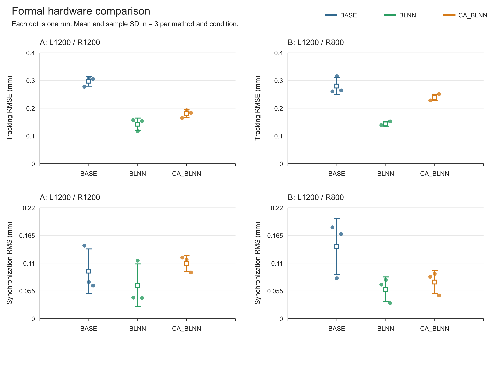
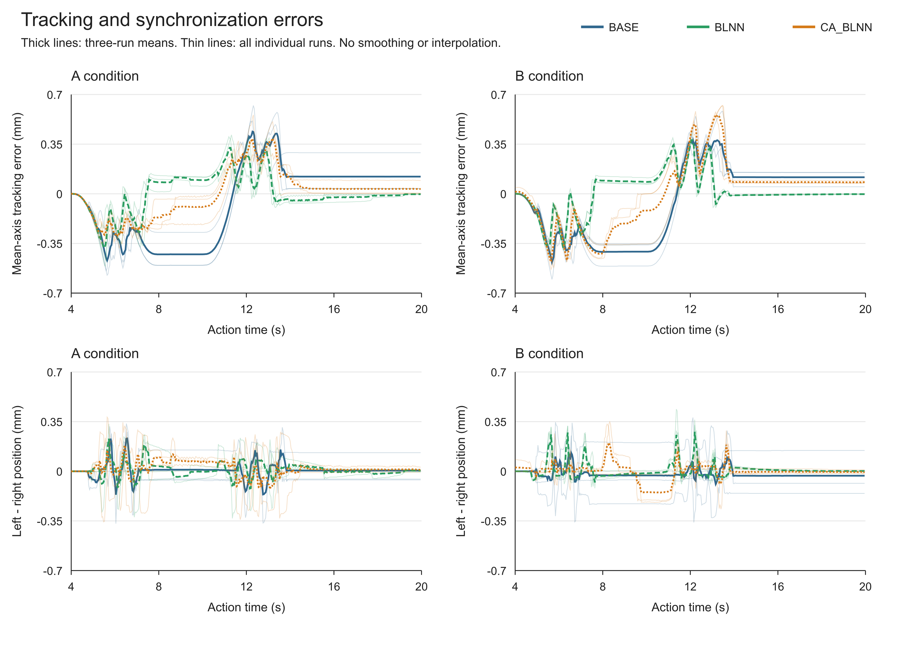
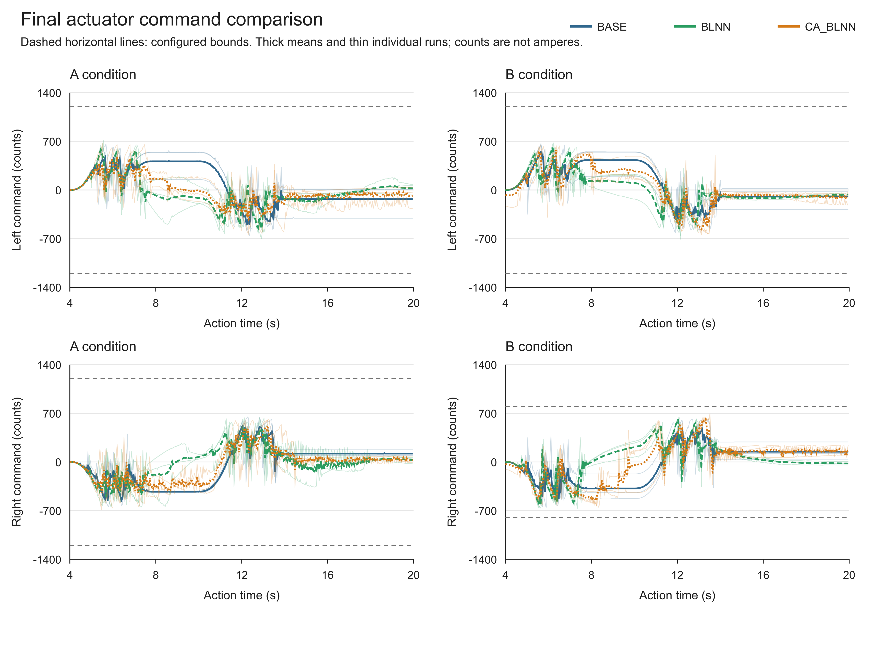
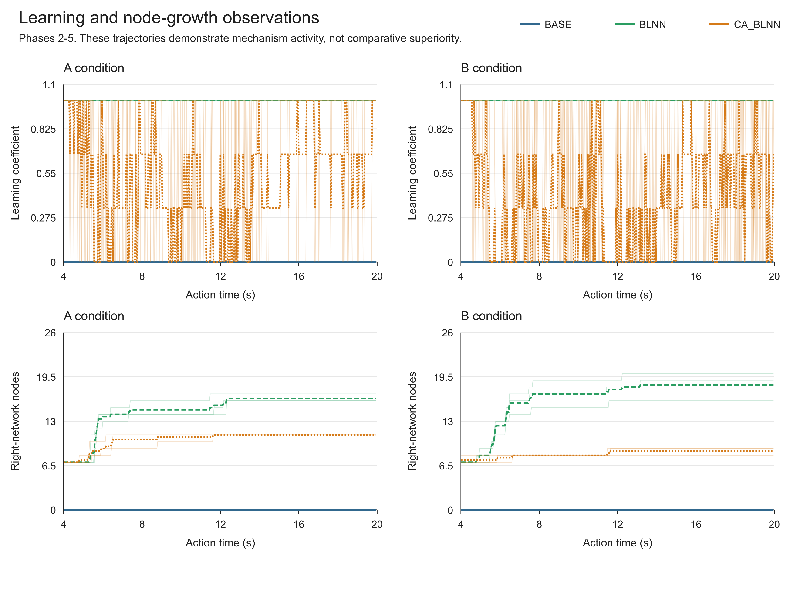

# 实验5：A/B正式实物数据整理与论文说明

整理日期：2026-10-11；状态：18个完整分析样本整理完成；原始文件保留。

## 1. 范围与实验条件

本次整理仅包含实验5正式 A、B 两工况：BASE、普通 BLNN、约束感知 CA_BLNN，每条件3次，共18个完整分析样本。保留23份正式原始 CSV（A 14份、B 9份）。不修改前四组封档、仿真快照或原始采集文件。此版本为整理快照，不是整篇论文或全部实验的最终封档。

两工况均按操作者所述无附加砝码、2 mm 往返。A 左/右指令界为1200/1200 counts，B 为1200/800 counts。counts 是控制指令计数，不是实测电流安培；I104=0 仅核对固件载荷标签，不是质量测量。两工况同时改变不对称性和总指令预算（2400降至2000），不能将差异仅归因于不对称性。

18个入选片段均核对107通道、HW6、固件构建/方法、限幅和载荷标签，完整经历 phase 0→6，故障为0，末帧两轴转速和指令为0，phase 6后尾段不少于5秒。阶段2-5均为400帧，名义间隔40 ms，动作时间4.00-19.96 s，无运动/稳定段缺帧；未插值、平滑或按性能挑选片段。通过的是记录完整性及已记录保护状态，不等于所有尝试均成功或所有未采样时刻均已验证。

## 2. 指标与统计口径

- 双轴跟踪 RMSE = sqrt(mean((eL^2+eR^2)/2))，eL=(xL-reference)×1000，eR=(xR-reference)×1000，单位 mm。
- 同步 RMS = sqrt(mean((xL-xR)^2))×1000，单位 mm。跟踪峰值取两轴绝对误差最大值，同步峰值取绝对同步误差最大值。
- 各次误差指标在同一阶段2-5的400帧计算。统计量是3次独立记录指标的均值与样本标准差（分母 n-1），不是将1200帧当成1200个独立实验；不作显著性或置信区间声明。
- 终点误差取所选完整片段的末帧位置相对归零原点的绝对值；不等于统一时刻的动态稳态误差，尾段长度不一。
- 指令 RMS/峰值和采样触边占比使用阶段2-5；占比阈值为 abs(command) >= limit-1。I61/I62是固件控制活动段累计硬边界次数，不与遥测采样占比混用。
- 学习系数均值/零学习比例和计算耗时样本均值/P95使用 I106=1 的阶段1-5（20秒）。图4只画阶段2-5（16秒），两者统计窗口不同。
- I42与I60为固件累计核心/整周期峰值耗时（us）。表中峰值均值是3次累计峰值的平均，并非完整最坏执行时间保证；40 ms遥测的样本耗时也不是全部1 ms周期分布。
- 图2展示双轴误差平均值 (eL+eR)/2 与有符号同步误差，不是双轴合并 RMSE。细线为3次原始运行，粗线为相同时间格点均值。

## 3. 结果：均值 ± 样本标准差

| 工况 | 方法 | n | 双轴跟踪 RMSE / mm | 同步 RMS / mm |
|---|---|---:|---:|---:|
| A | BASE | 3 | 0.298 ± 0.018 | 0.094 ± 0.044 |
| A | BLNN | 3 | 0.143 ± 0.022 | 0.066 ± 0.043 |
| A | CA_BLNN | 3 | 0.180 ± 0.014 | 0.110 ± 0.016 |
| B | BASE | 3 | 0.280 ± 0.031 | 0.143 ± 0.055 |
| B | BLNN | 3 | 0.143 ± 0.008 | 0.058 ± 0.024 |
| B | CA_BLNN | 3 | 0.239 ± 0.011 | 0.073 ± 0.023 |

A工况，普通 BLNN 相对 BASE 的平均跟踪 RMSE 降低52.1%，CA_BLNN降低39.4%；但 CA_BLNN 平均同步 RMS 为0.110 mm，高于 BASE 的0.094 mm。B工况，CA_BLNN 相对 BASE 跟踪 RMSE 降低14.5%，同步 RMS 降低49.3%，普通 BLNN在这两个平均指标上仍低于 CA_BLNN。不能写成 CA_BLNN 全面最优。

全部18次的 I61/I62 累计硬边界计数为0，阶段2-5的采样触边占比也均为0。左轴采样指令绝对峰值为615-720 counts，右轴为606-699 counts，B右界800未被触及。因此，本批证明短行程下的实物实现与基础跟踪表现，不能独立证明强执行器饱和条件下的抗饱和优势。图3直接保留配置边界与实际指令之间的距离。

CA_BLNN活动段平均学习系数：A 0.604，B 0.484；采样零学习占比：A 39.60%，B 51.60%。普通 BLNN 活动段学习系数固定为1。右网络末节点数均值：普通 BLNN A 16.33、B 18.33；CA_BLNN A 11.00、B 8.67。这表明门控/增长机制确有活动，不证明其单独导致性能提升。全部入选运行权值投影次数均为0，不能声称普通 BLNN 已发散而 CA 避免了发散。

## 4. 源文件映射与排除规则

同一 run 编号只占一个分析位置；优先使用满足完整性要求的指定文件，不以最小 RMSE 选样。三对带 _full 的文件在共同序列号上的数值行并不一致，不能仅凭后缀称为“同一次历史补导出”；本整理称为替代完整记录，真实重采/导出来源尚不能由CSV单独确认。全部对应旧文件保留但不重复计入统计，不据此推算独立尝试总数或成功率。

A_CA_BLNN_2 在 phase 0 的序列间隔缺4帧；A_CA_BLNN_3 在 phase 6 缺1帧，均不在阶段2-5比较窗口内，作为警告保留。A_BLNN_2 的首行是另一构建的非活动末状态，A_BLNN_3和B_BASE_1的首行识别号为0，按精确CSV行范围排除，原始文件未清洗或覆盖。

| 分析位置 | 构建 | 文件（原名不变） | 入选CSV行（含首尾，表头为1） | phase6后尾段/s |
|---|---:|---|---:|---:|
| A_BASE_1 | 61010 | E5F_A_BASE_HW6_L1200_R1200_M0g_S2mm_run01_full.csv | 2-834 | 6.72 |
| A_BASE_2 | 61010 | E5F_A_BASE_HW6_L1200_R1200_M0g_S2mm_run02.csv | 2-801 | 5.40 |
| A_BASE_3 | 61010 | E5F_A_BASE_HW6_L1200_R1200_M0g_S2mm_run03.csv | 2-843 | 7.08 |
| A_BLNN_1 | 61011 | E5F_A_BLNN_HW6_L1200_R1200_M0g_S2mm_run01_full.csv | 2-841 | 7.00 |
| A_BLNN_2 | 61011 | E5F_A_BLNN_HW6_L1200_R1200_M0g_S2mm_run02.csv | 3-795 | 5.88 |
| A_BLNN_3 | 61011 | E5F_A_BLNN_HW6_L1200_R1200_M0g_S2mm_run03_attempt02.csv | 3-764 | 6.12 |
| A_CA_BLNN_1 | 61012 | 5F_A_CA_BLNN_HW6_L1200_R1200_M0g_S2mm_run01.csv | 2-877 | 8.44 |
| A_CA_BLNN_2 | 61012 | E5F_A_CA_BLNN_HW6_L1200_R1200_M0g_S2mm_run02.csv | 2-814 | 6.08 |
| A_CA_BLNN_3 | 61012 | E5F_A_CA_BLNN_HW6_L1200_R1200_M0g_S2mm_run03_attempt02_full.csv | 2-1020 | 14.20 |
| B_BASE_1 | 63010 | E5F_B_BASE_HW6_L1200_R800_M0g_S2mm_run01.csv | 3-894 | 9.84 |
| B_BASE_2 | 63010 | E5F_B_BASE_HW6_L1200_R800_M0g_S2mm_run02.csv | 2-897 | 9.24 |
| B_BASE_3 | 63010 | E5F_B_BASE_HW6_L1200_R800_M0g_S2mm_run03.csv | 2-857 | 7.64 |
| B_BLNN_1 | 63011 | E5F_B_BLNN_HW6_L1200_R800_M0g_S2mm_run01.csv | 2-866 | 8.00 |
| B_BLNN_2 | 63011 | E5F_B_BLNN_HW6_L1200_R800_M0g_S2mm_run02.csv | 2-900 | 9.36 |
| B_BLNN_3 | 63011 | E5F_B_BLNN_HW6_L1200_R800_M0g_S2mm_run03.csv | 2-859 | 7.72 |
| B_CA_BLNN_1 | 63012 | E5F_B_CA_BLNN_HW6_L1200_R800_M0g_S2mm_run01.csv | 2-866 | 8.00 |
| B_CA_BLNN_2 | 63012 | E5F_B_CA_BLNN_HW6_L1200_R800_M0g_S2mm_run02.csv | 2-910 | 9.76 |
| B_CA_BLNN_3 | 63012 | E5F_B_CA_BLNN_HW6_L1200_R800_M0g_S2mm_run03.csv | 2-865 | 7.96 |

### 未纳入统计的5份正式A文件（保留原件）

- `E5F_A_BASE_HW6_L1200_R1200_M0g_S2mm_run01.csv`：phase6尾段2.840s，不足5s。
- `E5F_A_BLNN_HW6_L1200_R1200_M0g_S2mm_run01.csv`：phase3缺1帧；phase3样本不全。
- `E5F_A_BLNN_HW6_L1200_R1200_M0g_S2mm_run03.csv`：phase5缺1帧；phase5样本不全。
- `E5F_A_CA_BLNN_HW6_L1200_R1200_M0g_S2mm_run03.csv`：phase6尾段4.720s，不足5s。
- `E5F_A_CA_BLNN_HW6_L1200_R1200_M0g_S2mm_run03_attempt02.csv`：phase6尾段4.320s，不足5s。

未将这些技术性不完整导出自动判为独立失败试验，也不将替代文件自动判为同一次补导出。

## 5. 论文图说明

### 图1 各次误差指标与均值/样本标准差

圆点为3次运行，方块为均值，误差棒为样本标准差；A/B使用可比较坐标尺度，不表示置信区间。

### 图2 平均轴跟踪误差与同步误差时序

阶段2-5；细线3次、粗线均值；mean-axis error与合并双轴RMSE不是同一指标，无插值或平滑。

### 图3 最终指令及配置硬边界

阶段2-5的遥测最终指令，不是电流传感器实测值；灰虚线为配置边界。

### 图4 学习系数和右网络节点时序

阶段2-5的门控/增长活动；不将节点减少单独解释为精度提升。

## 6. 机制、限制与论述边界

- 全部18次的 I61/I62 累计硬边界计数为0，阶段2-5的采样触边占比也均为0。左轴采样指令绝对峰值为615-720 counts，右轴为606-699 counts，B右界800未被触及。因此，本批证明短行程下的实物实现与基础跟踪表现，不能独立证明强执行器饱和条件下的抗饱和优势。图3直接保留配置边界与实际指令之间的距离。
- 每条件仅3次完整记录；可作描述性对照，证据范围仅为所测无附加砝码、2 mm轨迹及这两组指令界。不能由此推出重载、长行程或所有电池状态下的效果。
- 电压和温度保留在逐次指标中。文件保存时间不能证明随机化或轮换执行顺序，未将运行顺序、温度、电池状态的影响解释为算法因果效果。
- 记录合格不等于整个试验历史可靠性为100%。本包没有所有独立尝试的完整现场日志，不能计算全尝试成功率。
- 实物固件使用已冻结的 HW6 正式实现。CA 包含整数可行分配、NN增量300 counts界、变化率/扇区/速度保护及学习门控；与冻结 MATLAB v3 仿真及参考英文论文不是逐公式逐参数一对一实现。BASE/BLNN/CA比较应称本项目三个实物控制版本；论文应明确嵌入式适配差异，不把本批描述为原论文数据的完全复现。
- CA_BLNN不是“使用宽度学习网络”本身的原创网络证明。可据本项目方法说明讨论可行域、门控和嵌入式部署贡献，但强饱和性能论据须区分仿真与本批实物证据；不得写成全球首创或所有指标最好。

## 7. 可用于论文结果段的初稿

为验证控制器的实物可运行性，在双驱机构上开展无附加砝码、2 mm往返实验，设置对称指令界 A（1200/1200 counts）和不对称指令界 B（1200/800 counts），分别对 BASE、普通 BLNN 和约束感知 CA_BLNN 采集3次完整记录。以阶段2-5的400帧计算双轴跟踪均方根误差和同步均方根误差，并报告重复实验指标的均值与样本标准差。在 B 工况下，CA_BLNN 相对 BASE 的上述两项平均误差分别降低14.5%和49.3%，但普通 BLNN 在这两项指标上更低；在 A 工况下，CA_BLNN 的同步误差未优于 BASE。两工况下 CA_BLNN 的学习门控和网络增长机制均呈现记录可见的活动。由于本批所有硬边界累计计数均为0，结论限于短行程实物运行与跟踪验证，不据此推断强饱和条件下的优势。

## 8. 固件与复现

A构建：BASE 61010、BLNN 61011、CA_BLNN 61012；B构建：63010、63011、63012。六套Keil工程与对应HEX均按已有发布清单验证源文件与HEX SHA256后复制。原发布清单是准备时快照，其中采集数量字段可能仍为0；本次完成情况以本报告及本次manifest为准，不改历史发布清单。

原始CSV不改名、不覆盖，文件SHA256和精确入选行范围保存在统计表与analysis.json。02_处理后数据包含完整入选片段（仍为107列）及400帧派生轨迹，均明确标为派生数据。

06_复现脚本提供analyze.mjs、冻结校验器、表格/图表/PDF构建脚本和reproduce.ps1。分析本身只需Node；表格依赖@oai/artifact-tool，PNG依赖sharp，PDF与独立校验依赖Python NumPy、ReportLab。包装不携带第三方运行库；本机一键脚本使用已安装Codex运行库，可生成新的复算目录，不覆盖本整理结果。异机需安装相应依赖并显式指定运行路径。

Python NumPy独立复核18次跟踪RMSE、同步RMS、两项峰值和6组均值/样本标准差，与JS计算差值小于1e-12；Excel公式复核通过，无公式错误。PDF逐页与4幅论文PNG均已进行视觉检查。

README说明整理包结构；manifest.json和SHA256SUMS.txt用于校验。整理仅固定本批数据/代码副本，不自动上传Git、不重烧固件、不删除原件。
